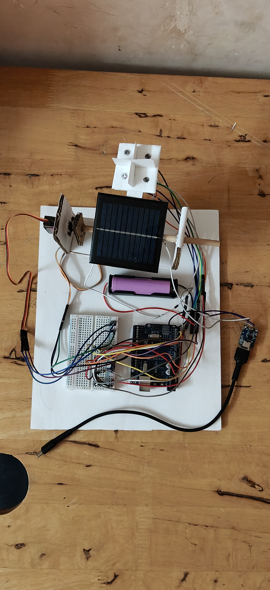
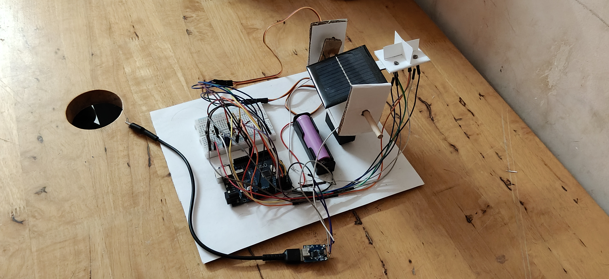

# Dual-Axis Solar Tracker

An Arduino-based prototype that uses four light-dependent resistors (LDRs) to locate a brighter light source and adjust its orientation along horizontal and vertical axes.

## How It Works

Four LDRs are arranged in a 2 × 2 pattern with a cross-divider between them. The divider casts shadows when the sensor head is not facing the light source. An Arduino Uno reads the four analog values, calibrates sensor offsets at startup, and compares the average readings on opposing sides. When the difference exceeds a deadband, two servos move one degree toward the brighter side.

## Hardware

- Arduino Uno
- Four LDR sensors and fixed resistors
- Two servo motors (the report identifies the horizontal servo as an MG996R)
- Cross-divider and mounting frame
- Breadboard, connecting wires, and a 5 V supply

The report recommends powering the servos from an adequate external 5 V supply and sharing ground with the Arduino.

## Connections

| Signal | Arduino pin |
| --- | --- |
| Top-left LDR | A0 |
| Top-right LDR | A1 |
| Bottom-left LDR | A2 |
| Bottom-right LDR | A3 |
| Horizontal (azimuth) servo | D9 |
| Vertical (elevation) servo | D10 |

## Control Details

- Startup calibration averages 25 readings per sensor, spaced 40 ms apart.
- The controller uses a 40-count ADC deadband to ignore small differences.
- Each servo moves in 1° steps, with travel limited to 20°–160°.
- Servo updates run every 50 ms; comma-separated sensor and angle telemetry is sent over serial every 500 ms at 9600 baud.
- The Arduino sketch uses the `Servo` library.

## Testing and Limitations

The report describes a flashlight demonstration, moving the light source to the left, right, above, and below the sensor head. The observation tables are blank, so no numerical tracking accuracy or energy improvement is claimed here.

Known practical limitations include ambient-light interference, residual sensor mismatch, servo backlash, and limited torque. The report proposes testing with a solar panel and measuring its voltage, current, and energy output as future work.

## Project Team

This was a group project. Contributors listed in the report:

- Tanmaya
- Umama Rihat
- V. Lokesh
- Vardhaan Gaikwad

  ## Prototype

